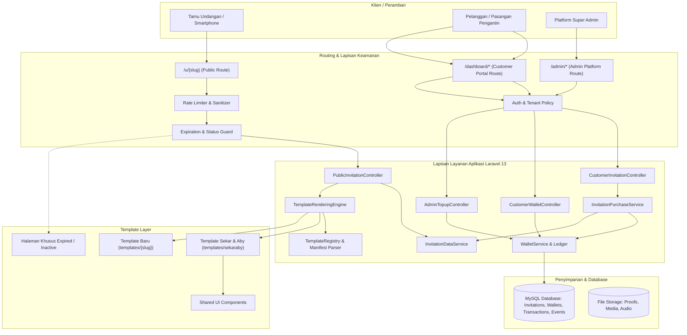
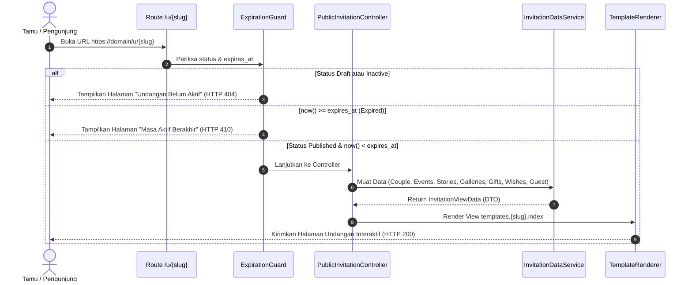

# Arsitektur Sistem Platform Undangan Digital
## Dokumen Desain Teknis & Arsitektur Perangkat Lunak

**Versi Dokumen:** 1.1.0  
**Status:** Ditetapkan Berdasarkan Keputusan Model Pembelian & Masa Aktif  
**Framework:** Laravel 13 (PHP 8.3+)  
**Frontend Stack:** Blade Component Engine, Vanilla CSS / Tailwind CSS v4, Vanilla JS / Alpine.js (opsional ringan), Vite  

---

## 1. Diagram Arsitektur Tingkat Tinggi (High-Level Architecture)



---

## 2. Arsitektur Dompet, Transaksi Pembelian, & Masa Aktif

Sesuai keputusan bisnis model pembelian satu kali (*one-time purchase*), sistem transaksi dan masa aktif dirancang dengan prinsip keandalan tinggi:

### 2.1 Alur Top-Up Saldo Dompet (Wallet Top-Up Flow)
```text
[Pelanggan] Mengajukan Top-Up (Nominal + Upload Bukti Transfer)
     │
     ▼
[Database] Record `topup_requests` dibuat (status: 'pending')
     │
     ▼
[Admin] Memeriksa Bukti Transfer & Mutasi Bank di /admin/topups
     │
     ├───> [Tolak / Reject] ──> Status: 'rejected' (saldo tidak berubah)
     │
     └───> [Setujui / Approve] ──> DB::transaction:
                                     - Status `topup_requests`: 'approved'
                                     - Saldo `wallets` bertambah
                                     - Record buku besar `wallet_transactions` dicatat
```

### 2.2 Transaksi Pembelian Template (Atomic Purchase Engine)
Setiap undangan dibuat melalui proses pembelian resmi menggunakan saldo dompet pelanggan:
1. **Pemeriksaan Saldo:** Sistem memeriksa saldo aktif pelanggan di tabel `wallets`.
2. **Pessimistic Locking (`lockForUpdate`):** Mencegah *race condition* atau pembelian ganda jika pelanggan menekan tombol beli berkali-kali secara simultan.
3. **Validasi Harga Template:** Mengambil harga terkini template dari database (`templates.price`).
4. **Eksekusi Transaksi Atomik (`DB::transaction`):**
   - Mendebit saldo dompet pelanggan (`wallets.balance = balance - price`).
   - Mencatat mutasi debit pada buku kas `wallet_transactions` (tipe: `purchase`).
   - Membuat record baru pada tabel `invitations`:
     - `template_id`: ID template terpilih.
     - `price_paid`: Snapshot harga beli saat itu.
     - `purchased_at`: Waktu transaksi berhasil (`now()`).
     - `expires_at`: Waktu kedaluwarsa (`now()->addDays($template->active_days)` default 365 hari).
     - `status`: `'draft'`.
5. **Independensi Pasca-Beli:**
   - Setelah undangan terbentuk, pengeditan konten pengantin, jadwal acara, galeri, dsb. **tidak memotong saldo pelanggan lagi**.
   - Perubahan harga template oleh Admin di masa depan tidak akan memengaruhi transaksi atau status undangan yang sudah terbeli.

---

## 3. Siklus Hidup & Penjaga Masa Aktif (Expiration Guard)

### 3.1 Status Undangan & Aturan Transisi
Terdapat empat status yang mengatur visibilitas undangan:
- **`draft`:** Default setelah pembelian. Hanya dapat dilihat oleh pemilik di dashboard.
- **`published`:** Aktif dan dapat diakses tamu publik melalui URL `/u/{slug}` selama `now() < expires_at`.
- **`inactive`:** Sengaja dinonaktifkan sementara oleh pelanggan. Halaman publik ditutup.
- **`expired`:** Masa aktif telah berakhir (`now() >= expires_at`).

### 3.2 Aturan Kunci Masa Aktif:
1. **Titik Awal Hitungan:** Masa aktif dihitung sejak tanggal pembelian (`purchased_at`), **bukan** dari tanggal pertama kali dipublikasikan.
2. **Nonaktifkan Tidak Menjeda Waktu:** Mengubah status menjadi `inactive` tidak menghentikan ataupun memperpanjang hitungan masa aktif.
3. **Tanpa Perpanjangan Otomatis (No Auto-Renewal):** Sistem tidak melakukan debit saldo otomatis saat masa aktif habis.
4. **Pemeriksaan Waktu Server Statis:**
   Pada controller publik `PublicInvitationController`, status `expired` dievaluasi langsung dari tanggal kedaluwarsa:
   ```php
   if ($invitation->expires_at && now()->greaterThanOrEqualTo($invitation->expires_at)) {
       return response()->view('public.expired', compact('invitation'), 410);
   }
   ```
5. **Retensi Konten:**
   Ketika masa aktif habis, seluruh data pengantin, acara, dan ucapan tetap tersimpan aman di database (tidak dihapus secara otomatis), sehingga siap jika suatu saat dibuka opsi perpanjangan di masa depan.

---

## 4. Alur Eksekusi Render Undangan Publik (`/u/{slug}`)



---

## 5. Arsitektur Multi-Template Dinamis

Tantangan utama adalah menjaga agar sistem backend tidak perlu diubah setiap kali menambah template baru.

### 5.1 Kontrak Data Terstandarisasi (Standardized Invitation DTO)
Seluruh template Blade visual mengonsumsi variabel terstandarisasi:
- `$invitation`: Model undangan (judul, slug, cover, music_url, quotes, expires_at).
- `$couple`: Array profil mempelai (`$couple['groom']` dan `$couple['bride']`).
- `$events`: Koleksi sesi acara (Akad, Resepsi, Unduh Mantu).
- `$stories`: Koleksi kisah cinta (opsional).
- `$galleries`: Koleksi foto & video prewedding (opsional).
- `$gifts`: Koleksi rekening & alamat kado (opsional).
- `$guest`: Data personal tamu yang sedang mengakses (jika ada parameter kode).
- `$wishes`: Koleksi ucapan doa yang telah disetujui.

### 5.2 Folder Template Mandiri & Manifes
Setiap template berada di `resources/views/templates/{template_slug}/`:
- Memiliki `manifest.json` yang mendefinisikan metadata, nama, versi, dan fitur yang didukung.
- Menggunakan `index.blade.php` sebagai entry point.
- Bebas mendesain sub-komponen visual, namun untuk interaksi kritis (form RSVP dan kirim ucapan) memanggil *shared component* agar pengiriman data ke backend tetap seragam dan aman.

---

## 6. Pemisahan Lingkup (Domain Separation)

1. **Admin Domain (`/admin/*`):**
   - Middleware: `auth`, `verified`, `role:admin`.
   - Mengelola katalog template, menetapkan harga & masa aktif default, memverifikasi pengajuan top-up saldo pelanggan, dan memoderasi konten global.
2. **Customer Dashboard Domain (`/dashboard/*`):**
   - Middleware: `auth`, `verified`.
   - Mengelola dompet saldo, pengajuan top-up, pembelian template dengan saldo, CRUD multi-undangan mandiri, manajemen tamu, dan monitoring RSVP.
3. **Public Invitation Domain (`/u/{slug}`):**
   - Tanpa login.
   - Dilindungi pembatasan rate limit (`throttle:6,1`) pada endpoint POST ucapan & RSVP.
   - Dilindungi *Expiration Guard* untuk memblokir akses jika undangan telah kedaluwarsa.
