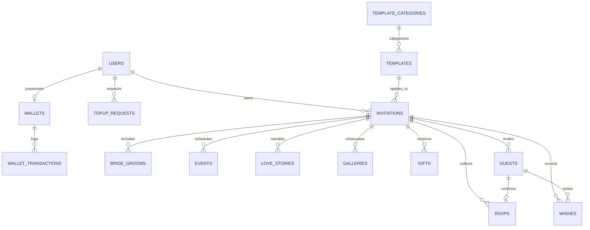

# Desain & Skema Database Platform Undangan Digital
## Relasi Entitas, Indeks, & Struktur Data

**Versi Dokumen:** 1.1.0  
**Database RDBMS:** MySQL 8.0+  
**ORM:** Laravel Eloquent (Laravel 13)  
**Status:** Ditetapkan Berdasarkan Keputusan Final Model Pembelian & Masa Aktif  

---

## 1. Diagram Relasi Entitas (Entity-Relationship Diagram)

---

## 2. Struktur Tabel & Rincian Kolom

### 2.1 `users` (Pengguna Platform)
Menyimpan akun super admin dan pelanggan.
| Kolom | Tipe | Constraint / Keterangan |
|---|---|---|
| `id` | BIGINT UNSIGNED | Primary Key, Auto Increment |
| `name` | VARCHAR(255) | Nama lengkap pengguna |
| `email` | VARCHAR(255) | Unique, Index |
| `email_verified_at` | TIMESTAMP | Nullable |
| `password` | VARCHAR(255) | Hashed password |
| `role` | ENUM('admin', 'customer') | Default: 'customer', Index |
| `status` | ENUM('active', 'suspended') | Default: 'active' |
| `phone_number` | VARCHAR(30) | Nullable |
| `remember_token` | VARCHAR(100) | Nullable |
| `created_at`, `updated_at` | TIMESTAMP | Standard Laravel |

---

### 2.2 `wallets` (Dompet Saldo Pelanggan)
Menyimpan saldo terkini milik setiap pelanggan untuk pembelian undangan satu kali (*one-time purchase*).
| Kolom | Tipe | Constraint / Keterangan |
|---|---|---|
| `id` | BIGINT UNSIGNED | Primary Key, Auto Increment |
| `user_id` | BIGINT UNSIGNED | Foreign Key -> `users.id` ON DELETE CASCADE, Unique Index |
| `balance` | DECIMAL(12, 2) UNSIGNED | Default: 0.00, Saldo aktif (tidak boleh negatif) |
| `created_at`, `updated_at` | TIMESTAMP | Standard Laravel |

---

### 2.3 `topup_requests` (Pengajuan Top-Up Saldo)
Catatan pengajuan penambahan saldo oleh pelanggan yang diverifikasi manual oleh Admin.
| Kolom | Tipe | Constraint / Keterangan |
|---|---|---|
| `id` | BIGINT UNSIGNED | Primary Key, Auto Increment |
| `user_id` | BIGINT UNSIGNED | Foreign Key -> `users.id` ON DELETE CASCADE, Index |
| `amount` | DECIMAL(12, 2) UNSIGNED | Nominal pengisian saldo (misal: 100000.00) |
| `proof_image` | VARCHAR(500) | Path file gambar bukti struk transfer bank |
| `status` | ENUM('pending', 'approved', 'rejected') | Default: 'pending', Index |
| `admin_notes` | TEXT | Nullable, catatan admin (misal alasan penolakan) |
| `verified_by` | BIGINT UNSIGNED | Nullable, Foreign Key -> `users.id` ON DELETE SET NULL (Admin yang memvalidasi) |
| `verified_at` | TIMESTAMP | Nullable, waktu verifikasi disetujui/ditolak |
| `created_at`, `updated_at` | TIMESTAMP | Standard Laravel |

---

### 2.4 `wallet_transactions` (Buku Kas & Riwayat Mutasi Saldo)
Mencatat seluruh mutasi debet/kredit dompet untuk audit keuangan yang transparan.
| Kolom | Tipe | Constraint / Keterangan |
|---|---|---|
| `id` | BIGINT UNSIGNED | Primary Key, Auto Increment |
| `wallet_id` | BIGINT UNSIGNED | Foreign Key -> `wallets.id` ON DELETE CASCADE, Index |
| `type` | ENUM('topup', 'purchase', 'adjustment') | Index |
| `amount` | DECIMAL(12, 2) | Nominal perubahan saldo (positif jika masuk, negatif jika keluar) |
| `balance_before` | DECIMAL(12, 2) | Saldo sebelum transaksi dieksekusi |
| `balance_after` | DECIMAL(12, 2) | Saldo setelah transaksi dieksekusi |
| `reference_type` | VARCHAR(100) | Nullable (misal: 'App\Models\TopupRequest' atau 'App\Models\Invitation') |
| `reference_id` | BIGINT UNSIGNED | Nullable, ID referensi objek transaksi |
| `description` | VARCHAR(255) | Keterangan mutasi (misal: "Top-Up Disetujui Admin" / "Pembelian Template Sekar & Aby") |
| `created_at` | TIMESTAMP | Waktu mutasi |

---

### 2.5 `template_categories` (Kategori Tema Template)
| Kolom | Tipe | Constraint / Keterangan |
|---|---|---|
| `id` | BIGINT UNSIGNED | Primary Key, Auto Increment |
| `name` | VARCHAR(100) | Nama kategori (misal: Tradisional Jawa, Modern Minimalist, Floral, Rustic) |
| `slug` | VARCHAR(100) | Unique, Index |
| `description` | TEXT | Nullable |
| `sort_order` | INT | Default: 0 |
| `created_at`, `updated_at` | TIMESTAMP | Standard Laravel |

---

### 2.6 `templates` (Katalog Template & Penetapan Harga)
Daftar template undangan yang terpasang di platform beserta konfigurasi harga dinamis.
| Kolom | Tipe | Constraint / Keterangan |
|---|---|---|
| `id` | BIGINT UNSIGNED | Primary Key, Auto Increment |
| `category_id` | BIGINT UNSIGNED | Foreign Key -> `template_categories.id` ON DELETE SET NULL, Index |
| `name` | VARCHAR(150) | Nama template (misal: Sekar & Aby) |
| `slug` | VARCHAR(100) | Unique, Index (kode folder di `views/templates/`) |
| `price` | DECIMAL(12, 2) UNSIGNED | Default: 75000.00, Harga beli satu kali (ditetapkan oleh Admin) |
| `active_days` | INT UNSIGNED | Default: 365, Masa aktif default dalam hitungan hari |
| `thumbnail_url` | VARCHAR(500) | Path/URL gambar pratinjau |
| `description` | TEXT | Nullable |
| `version` | VARCHAR(20) | Default: '1.0.0' |
| `is_active` | BOOLEAN | Default: true (apakah template dapat dibeli pelanggan) |
| `is_premium` | BOOLEAN | Default: false |
| `supported_modules` | JSON | Fitur yang didukung (misal: stories, countdown, gift) |
| `default_config` | JSON | Palet warna & pengaturan font bawaan |
| `created_at`, `updated_at` | TIMESTAMP | Standard Laravel |

---

### 2.7 `invitations` (Data Induk Undangan)
Entitas utama setiap undangan milik pelanggan. Satu pelanggan dapat memiliki banyak undangan.
| Kolom | Tipe | Constraint / Keterangan |
|---|---|---|
| `id` | BIGINT UNSIGNED | Primary Key, Auto Increment |
| `user_id` | BIGINT UNSIGNED | Foreign Key -> `users.id` ON DELETE CASCADE, Index |
| `template_id` | BIGINT UNSIGNED | Foreign Key -> `templates.id` ON DELETE RESTRICT, Index |
| `title` | VARCHAR(200) | Judul undangan (misal: The Wedding of Sekar & Aby) |
| `slug` | VARCHAR(150) | Unique Index (URL publik: `/u/{slug}`) |
| `event_type` | VARCHAR(50) | Default: 'wedding' |
| `status` | ENUM('draft', 'published', 'inactive', 'expired') | Default: 'draft', Index |
| `price_paid` | DECIMAL(12, 2) UNSIGNED | Snapshot harga template saat dibeli |
| `purchased_at` | TIMESTAMP | Waktu transaksi pembelian berhasil |
| `expires_at` | TIMESTAMP | Waktu kedaluwarsa (`purchased_at + active_days`), Index |
| `cover_photo` | VARCHAR(500) | Nullable, path foto sampul utama |
| `music_url` | VARCHAR(500) | Nullable, path/URL file audio lagu latar |
| `quote_title` | VARCHAR(255) | Nullable (misal: Surat Ar-Rum : 21) |
| `quote_content` | TEXT | Nullable, isi kutipan atau doa pembuka |
| `quote_source` | VARCHAR(255) | Nullable |
| `primary_lang` | VARCHAR(10) | Default: 'id' ('id' / 'en') |
| `is_multilingual` | BOOLEAN | Default: false |
| `custom_config` | JSON | Nullable, penyesuaian warna/font spesifik undangan |
| `created_at`, `updated_at` | TIMESTAMP | Standard Laravel |

---

### 2.8 `bride_grooms` (Profil Mempelai)
Menyimpan profil pengantin pria dan wanita pada undangan.
| Kolom | Tipe | Constraint / Keterangan |
|---|---|---|
| `id` | BIGINT UNSIGNED | Primary Key, Auto Increment |
| `invitation_id` | BIGINT UNSIGNED | Foreign Key -> `invitations.id` ON DELETE CASCADE, Index |
| `gender` | ENUM('male', 'female') | Index |
| `call_name` | VARCHAR(100) | Nama panggilan (misal: Sekar / Aby) |
| `full_name` | VARCHAR(255) | Nama lengkap bergelar |
| `order_text` | VARCHAR(100) | Nullable (misal: Putri pertama dari...) |
| `father_name` | VARCHAR(200) | Nullable |
| `mother_name` | VARCHAR(200) | Nullable |
| `instagram` | VARCHAR(100) | Nullable (username Instagram tanpa @) |
| `photo_url` | VARCHAR(500) | Nullable, foto potret mempelai |
| `order_index` | INT | Default: 1 (urutan render: 1 pria, 2 wanita atau sebaliknya) |
| `created_at`, `updated_at` | TIMESTAMP | Standard Laravel |

---

### 2.9 `events` (Jadwal & Sesi Acara)
Menampung multi-sesi acara (Akad Nikah, Pemberkatan, Resepsi, Unduh Mantu).
| Kolom | Tipe | Constraint / Keterangan |
|---|---|---|
| `id` | BIGINT UNSIGNED | Primary Key, Auto Increment |
| `invitation_id` | BIGINT UNSIGNED | Foreign Key -> `invitations.id` ON DELETE CASCADE, Index |
| `event_type` | VARCHAR(50) | 'akad', 'reception', 'holy_matrimony', 'custom' |
| `title` | VARCHAR(150) | Judul sesi acara |
| `event_date` | DATE | Tanggal acara |
| `start_time` | TIME | Waktu mulai |
| `end_time` | TIME | Nullable, waktu selesai |
| `timezone` | VARCHAR(10) | Default: 'WIB' ('WIB', 'WITA', 'WIT') |
| `location_name` | VARCHAR(255) | Nama tempat/gedung/rumah |
| `location_address` | TEXT | Alamat lengkap |
| `google_maps_url` | TEXT | Nullable, tautan peta Google Maps |
| `dresscode` | VARCHAR(255) | Nullable, ketentuan busana tamu |
| `notes` | TEXT | Nullable, catatan khusus sesi |
| `is_main_event` | BOOLEAN | Default: false (penentu acuan Countdown Timer) |
| `sort_order` | INT | Default: 0 |
| `created_at`, `updated_at` | TIMESTAMP | Standard Laravel |

---

### 2.10 `love_stories` (Linimasa Perjalanan Cinta)
| Kolom | Tipe | Constraint / Keterangan |
|---|---|---|
| `id` | BIGINT UNSIGNED | Primary Key, Auto Increment |
| `invitation_id` | BIGINT UNSIGNED | Foreign Key -> `invitations.id` ON DELETE CASCADE, Index |
| `year_date` | VARCHAR(50) | Label waktu (misal: "2022", "14 Februari 2023") |
| `title` | VARCHAR(150) | Judul momen (misal: "First Met") |
| `story` | TEXT | Narasi kisah |
| `image_url` | VARCHAR(500) | Nullable |
| `sort_order` | INT | Default: 0 |
| `created_at`, `updated_at` | TIMESTAMP | Standard Laravel |

---

### 2.11 `galleries` (Galeri Foto & Video)
| Kolom | Tipe | Constraint / Keterangan |
|---|---|---|
| `id` | BIGINT UNSIGNED | Primary Key, Auto Increment |
| `invitation_id` | BIGINT UNSIGNED | Foreign Key -> `invitations.id` ON DELETE CASCADE, Index |
| `media_type` | ENUM('image', 'youtube_video') | Default: 'image' |
| `media_url` | VARCHAR(500) | Path berkas gambar atau URL video |
| `caption` | VARCHAR(255) | Nullable |
| `sort_order` | INT | Default: 0 |
| `created_at`, `updated_at` | TIMESTAMP | Standard Laravel |

---

### 2.12 `gifts` (Tanda Kasih / Rekening Bank & Alamat Kado)
| Kolom | Tipe | Constraint / Keterangan |
|---|---|---|
| `id` | BIGINT UNSIGNED | Primary Key, Auto Increment |
| `invitation_id` | BIGINT UNSIGNED | Foreign Key -> `invitations.id` ON DELETE CASCADE, Index |
| `gift_type` | ENUM('bank', 'ewallet', 'physical_address') | Index |
| `provider_name` | VARCHAR(100) | Nama bank (BCA, Mandiri) atau dompet digital |
| `account_number` | VARCHAR(100) | Nullable, nomor rekening atau e-wallet |
| `account_holder` | VARCHAR(150) | Nullable, nama pemilik rekening |
| `physical_address` | TEXT | Nullable, alamat penerima barang |
| `receiver_name` | VARCHAR(150) | Nullable, nama penerima paket kado |
| `created_at`, `updated_at` | TIMESTAMP | Standard Laravel |

---

### 2.13 `guests` (Daftar Tamu Undangan)
| Kolom | Tipe | Constraint / Keterangan |
|---|---|---|
| `id` | BIGINT UNSIGNED | Primary Key, Auto Increment |
| `invitation_id` | BIGINT UNSIGNED | Foreign Key -> `invitations.id` ON DELETE CASCADE, Index |
| `code` | VARCHAR(50) | Kode unik tamu (misal: TAMU-P001), Index |
| `name` | VARCHAR(200) | Nama tamu undangan |
| `phone_number` | VARCHAR(30) | Nullable (format nomor HP WhatsApp) |
| `category` | VARCHAR(100) | Nullable (Keluarga, Sahabat, VIP) |
| `max_seats` | INT | Default: 2 (jatah kuota kehadiran) |
| `status` | ENUM('pending', 'opened', 'confirmed') | Default: 'pending' |
| `created_at`, `updated_at` | TIMESTAMP | Standard Laravel |

**Indeks Khusus:** `UNIQUE KEY idx_invitation_guest_code (invitation_id, code)`

---

### 2.14 `rsvps` (Konfirmasi Kehadiran Tamu)
| Kolom | Tipe | Constraint / Keterangan |
|---|---|---|
| `id` | BIGINT UNSIGNED | Primary Key, Auto Increment |
| `invitation_id` | BIGINT UNSIGNED | Foreign Key -> `invitations.id` ON DELETE CASCADE, Index |
| `guest_id` | BIGINT UNSIGNED | Nullable, Foreign Key -> `guests.id` ON DELETE SET NULL |
| `sender_name` | VARCHAR(200) | Nama yang mengisi konfirmasi |
| `attendance_status` | ENUM('attending', 'not_attending') | Index |
| `total_guests` | INT | Default: 1 (jumlah orang yang akan hadir) |
| `notes` | TEXT | Nullable |
| `ip_address` | VARCHAR(45) | Nullable |
| `user_agent` | TEXT | Nullable |
| `created_at`, `updated_at` | TIMESTAMP | Standard Laravel |

---

### 2.15 `wishes` (Buku Tamu / Dinding Doa & Ucapan)
| Kolom | Tipe | Constraint / Keterangan |
|---|---|---|
| `id` | BIGINT UNSIGNED | Primary Key, Auto Increment |
| `invitation_id` | BIGINT UNSIGNED | Foreign Key -> `invitations.id` ON DELETE CASCADE, Index |
| `guest_id` | BIGINT UNSIGNED | Nullable, Foreign Key -> `guests.id` ON DELETE SET NULL |
| `sender_name` | VARCHAR(200) | Nama pemberi ucapan |
| `message` | TEXT | Pesan doa dan ucapan |
| `is_approved` | BOOLEAN | Default: true (moderasi komentar) |
| `is_pinned` | BOOLEAN | Default: false (pin ke atas daftar) |
| `ip_address` | VARCHAR(45) | Nullable |
| `created_at`, `updated_at` | TIMESTAMP | Standard Laravel |

---

## 3. Strategi Integritas & Keamanan Transaksi Database

1. **Konsistensi Saldo Dompet & Pencegahan Race Condition:**
   - Transaksi pembelian template selalu mengunci baris saldo pelanggan dengan `wallets.lockForUpdate()`.
   - Saldo dompet memiliki constraint `UNSIGNED` sehingga transaksi yang menyebabkan saldo minus akan otomatis di-reject pada level database jika validasi aplikasi lolos secara tak sengaja.
2. **Snapshot Harga Pembelian:**
   - Kolom `price_paid` pada tabel `invitations` mencatat harga nominal tepat saat transaksi selesai. Jika Admin mengubah harga template di kemudian hari, nilai `price_paid` pada undangan lama tidak pernah berubah.
3. **Penyimpanan Masa Aktif:**
   - `purchased_at` mencatat waktu beli.
   - `expires_at` dihitung otomatis: `purchased_at + active_days` (default 365 hari).
   - Indeks pada kolom `expires_at` dan `status` mempercepat query pengecekan akses publik.
4. **Retensi Data Pasca-Expired:**
   - Saat `now() >= expires_at`, baris data di `invitations` dan relasinya **tetap dipertahankan** (tidak di-drop / tidak di-cascade delete) demi menjaga hak kepemilikan data pelanggan untuk opsi masa depan.
