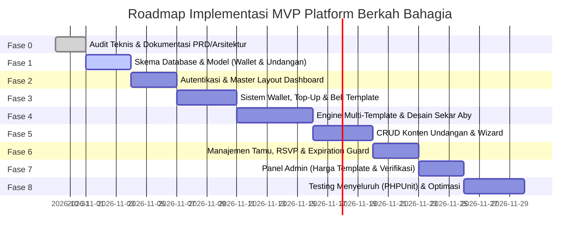

# Rencana Kerja & Roadmap Implementasi (Implementation Roadmap)
## Tahapan Pengembangan Platform Undangan Digital "Berkah Bahagia" (Fokus MVP)

**Versi Dokumen:** 1.1.0  
**Status:** Disesuaikan Berdasarkan Keputusan Model Pembelian & Batasan Scope MVP  

---

## 1. Fokus Ruang Lingkup MVP (Minimum Viable Product)

Fokus utama MVP adalah menghadirkan alur bisnis inti yang stabil, aman, dan dapat digunakan secara nyata:
1. Registrasi dan login pelanggan.
2. Dashboard pelanggan untuk mengelola banyak undangan sekaligus.
3. Dompet (*wallet*) dan pencatatan saldo pelanggan.
4. Pengajuan pengisian saldo (*top-up*) oleh pelanggan dengan upload bukti transfer.
5. Verifikasi dan persetujuan pengajuan top-up oleh admin.
6. Pembelian template satu kali (*one-time purchase*) menggunakan pemotongan saldo secara atomik.
7. CRUD konten undangan (data mempelai, jadwal multi-acara, cerita cinta, galeri media, tanda kasih).
8. Pengaturan status publikasi undangan (*draft*, *published*, *inactive*, *expired*).
9. Penetapan masa aktif 1 tahun (365 hari) sejak pembelian berhasil.
10. Pembatasan akses publik secara otomatis ketika masa aktif undangan telah kedaluwarsa.

### Fitur yang DITUNDA dari Scope MVP:
- **Perpanjangan masa aktif (Renewal):** Belum ada tombol, alur transaksi, biaya perpanjangan, maupun sistem *auto-renewal*.
- **Payment Gateway Otomatis:** Menggunakan alur verifikasi top-up transfer bank manual oleh Admin.
- **Editor Visual Drag-and-Drop:** Menggunakan formulir wizard terstruktur yang teruji dan bebas galat layout.

---

## 2. Diagram Alur Fase Implementasi

---

## 3. Rincian Setiap Fase Implementasi

### Fase 0: Audit & Perencanaan Arsitektur *(Selesai)*
- **Tujuan:** Audit basis kode Laravel 13, analisis website referensi Invitato Sekar & Aby, penyelarasan keputusan model pembelian satu kali, dan penyusunan dokumentasi teknis lengkap.
- **Output:**
  - `docs/PRD.md`, `docs/ARCHITECTURE.md`, `docs/DATABASE.md`, `docs/DESIGN_SYSTEM.md`, `docs/TEMPLATE_GUIDE.md`, `docs/SECURITY.md`, `docs/ROADMAP.md`, `README.md`, `AGENTS.md`.

---

### Fase 1: Fondasi Database, Model Eloquent, & Relasi
- **Tujuan:** Membangun seluruh tabel database dengan constraint, foreign key, dan model Eloquent yang solid.
- **Rincian Tugas:**
  - Migrasi dompet & keuangan: `wallets`, `topup_requests`, `wallet_transactions`.
  - Migrasi template & harga: `template_categories`, `templates` (kolom `price` dan `active_days`).
  - Migrasi undangan & masa aktif: `invitations` (kolom `price_paid`, `purchased_at`, `expires_at`, status `draft`/`published`/`inactive`/`expired`).
  - Migrasi konten: `bride_grooms`, `events`, `love_stories`, `galleries`, `gifts`, `guests`, `rsvps`, `wishes`.
  - Pembuatan Model Eloquent, relasi, cast tipe data, dan Seeder data awal (Kategori, Template Sekar Aby Rp75.000, Super Admin).
- **Kriteria Keberhasilan:** `php artisan migrate:fresh --seed` berjalan sukses tanpa error.

---

### Fase 2: Autentikasi Pengguna & Layout Dashboard Multi-Undangan
- **Tujuan:** Membangun sistem login, registrasi akun pelanggan, verifikasi peran (Admin vs Customer), dan kerangka antarmuka pengguna.
- **Rincian Tugas:**
  - Konfigurasi sistem autentikasi ringan berbasis Blade & Tailwind CSS v4.
  - Implementasi Middleware `EnsureUserRole` (membedakan rute `/admin/*` dan `/dashboard/*`).
  - Pembuatan Layout Dashboard Pelanggan yang mendukung pengelolaan banyak undangan.
- **Kriteria Keberhasilan:** Pengguna dapat mendaftar, login, dan melihat dashboard akun dengan kerangka navigasi yang bersih.

---

### Fase 3: Sistem Dompet (Wallet), Pengajuan Top-Up, & Transaksi Pembelian Template
- **Tujuan:** Menghadirkan alur transaksi pengisian saldo dan pembelian undangan satu kali.
- **Rincian Tugas:**
  - Pembuatan `WalletService`: inisialisasi dompet saat registrasi, penambahan saldo, dan pencatatan buku kas `wallet_transactions`.
  - Form pengajuan top-up saldo oleh pelanggan (pilihan nominal + upload bukti struk transfer).
  - Halaman Admin untuk verifikasi antrean top-up: tombol *Approve* (saldo bertambah otomatis) dan *Reject*.
  - Pembuatan `InvitationPurchaseService`: pemotongan saldo secara atomik dengan `lockForUpdate()`, snapshot `price_paid`, penentuan `expires_at` (1 tahun), dan pembuatan draf undangan baru.
- **Kriteria Keberhasilan:** Pelanggan dapat mengajukan top-up, admin menyetujui, dan saldo dapat digunakan untuk membeli template undangan tanpa galat saldo minus atau double-spending.

---

### Fase 4: Core Multi-Template Rendering Engine & Template "Sekar & Aby"
- **Tujuan:** Membangun mesin rendering dinamis dan mengimplementasikan template visual perdana Sekar & Aby.
- **Rincian Tugas:**
  - Service `TemplateRenderer` dan `InvitationDataService` (membentuk DTO terstandarisasi).
  - Pembangunan folder `resources/views/templates/sekaraby/` lengkap dengan `manifest.json`.
  - Implementasi komponen visual: Cover Gate fullscreen (animasi burung melintas & bunga bergoyang), musik latar otomatis, potret pengantin berbingkai oval keemasan, linimasa kisah cinta, hitung mundur + tombol Google Calendar, kartu sesi acara + Google Maps, tanda kasih digital (salin nomor rekening), form RSVP, dan dinding doa.
  - Floating controls dock (Audio music toggle & Nav drawer).
- **Kriteria Keberhasilan:** Undangan publik `/u/{slug}` merender desain Sekar & Aby dengan sempurna pada layar ponsel maupun desktop view sentral.

---

### Fase 5: CRUD Konten Undangan & Kontrol Status Publikasi
- **Tujuan:** Memungkinkan pelanggan mengisi dan mengedit konten undangan yang telah dibeli secara mandiri.
- **Rincian Tugas:**
  - Form multi-langkah (Wizard):
    1. Pengaturan Dasar & Judul Undangan.
    2. Data Kedua Mempelai (pria & wanita, gelar, orang tua, foto, instagram).
    3. Sesi Acara (Akad Nikah & Resepsi, tanggal, jam, alamat, Google Maps).
    4. Kisah Cinta & Galeri Media Foto.
    5. Tanda Kasih Digital (rekening bank & alamat kado fisik).
  - Validasi file upload aman (foto potret, cover, dan lagu MP3).
  - Kontrol status publikasi: tombol toggle *Publish* (status menjadi `published`) dan *Unpublish* (status menjadi `inactive`).
  - Tampilan sisa masa aktif dan tanggal kedaluwarsa pada kartu undangan di dashboard.
- **Kriteria Keberhasilan:** Pelanggan dapat mengisi seluruh data undangan dan mengontrol status publikasinya secara mandiri.

---

### Fase 6: Manajemen Tamu, Buku Tamu, & Penjaga Masa Aktif (Expiration Guard)
- **Tujuan:** Interaksi dua arah dengan tamu dan penegakan pembatasan akses undangan kedaluwarsa.
- **Rincian Tugas:**
  - CRUD daftar tamu dan generator pesan personalisasi siap kirim ke WhatsApp.
  - Endpoint publik AJAX untuk pengiriman konfirmasi RSVP dan doa/ucapan dengan proteksi sanitasi XSS dan rate limit.
  - Fitur moderasi ucapan dan sematkan (*pin*) ucapan favorit oleh pemilik undangan.
  - Implementasi *Expiration Guard* pada rute `/u/{slug}`:
    - Jika `now() >= expires_at` -> Tampilkan halaman sopan bahwa masa aktif undangan telah berakhir (HTTP 410).
    - Jika status `draft` atau `inactive` -> Tampilkan halaman 404 Not Found bagi publik.
- **Kriteria Keberhasilan:** Tamu dapat mengirim RSVP dan ucapan, dan undangan yang habis masa aktifnya otomatis terblokir dari akses publik.

---

### Fase 7: Panel Platform Admin
- **Tujuan:** Kontrol operasional menyeluruh bagi pengelola platform.
- **Rincian Tugas:**
  - Dashboard analitik metrik (total pengguna, saldo beredar, transaksi pembelian template, undangan aktif/kedaluwarsa).
  - Manajemen Template: Tambah/edit template, atur harga masing-masing template, atur masa aktif default, dan toggle status aktif.
  - Manajemen Pengguna: Pantau pengguna terdaftar dan tangguhkan (*suspend*) akun pelanggar.
  - Audit log mutasi dompet dan riwayat transaksi pembelian.
- **Kriteria Keberhasilan:** Admin dapat mengatur harga template secara fleksibel dan memantau seluruh aktivitas finansial serta operasional platform.

---

### Fase 8: Pengujian Menyeluruh, Optimasi Performa, & Persiapan Produksi
- **Tujuan:** Menjamin stabilitas, keamanan transaksi, dan performa tinggi sebelum peluncuran.
- **Rincian Tugas:**
  - Penulisan Automated Tests (PHPUnit):
    - Uji pemotongan saldo atomik dan penolakan saldo minus.
    - Uji isolasi tenant (Pelanggan A tidak bisa mengedit undangan Pelanggan B).
    - Uji penolakan akses publik ketika `now() >= expires_at`.
    - Uji sanitasi XSS pada form ucapan publik.
  - Optimasi kompresi gambar ke format WebP dan kompresi bundle CSS/JS Vite.
  - Pemeriksaan akhir kesiapan deployment produksi.
- **Kriteria Keberhasilan:** Seluruh test suite lolos (`php artisan test`), nol celah otorisasi/finansial, dan performa Lighthouse > 90.
